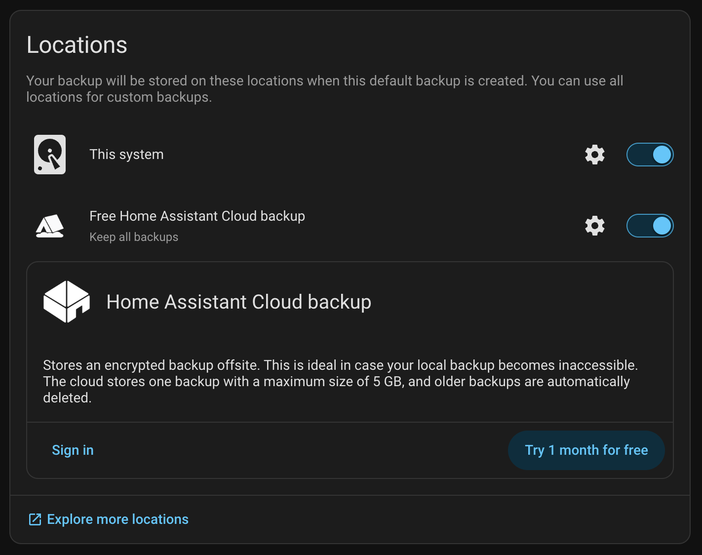
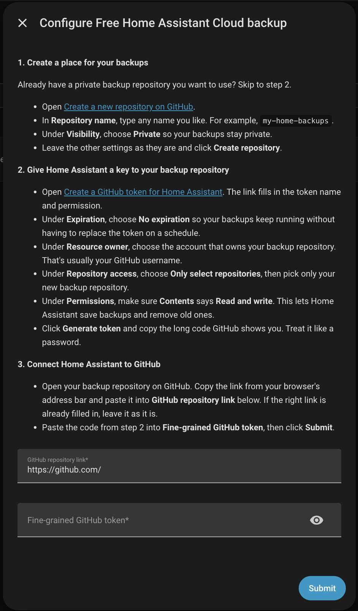

<h1 align="center">Free Home Assistant Cloud backup</h1>

<p align="center">
  <strong>Free, encrypted off-site backups for Home Assistant.</strong>
  Store them in your own private GitHub repository.
</p>

<p align="center">
  <a href="https://my.home-assistant.io/redirect/marketplace_repository/?owner=CodingRac&amp;repository=Free-Home-Assistant-Cloud-backup&amp;category=integration"></a>
</p>

<p align="center">
  <strong>Home Assistant 2026.11+</strong> · Tested on Home Assistant Container 2026.11.1 · <a href="LICENSE">GPLv3</a>
</p>

## What it does

- Adds GitHub to **Backup Locations**. Home Assistant handles the schedule and decides how many automatic backups to keep. Leave **This system** enabled to keep a local copy too.
- Uploads encrypted `.tar` archives to **Releases** in a private repository you own.
- Lets you download an archive from GitHub and restore it with your **Backup emergency kit**, even if your original Home Assistant instance is offline.

<p align="center">
  
</p>

## How it compares with Home Assistant Cloud

**Keep multiple encrypted off-site backups for free.** Use a free GitHub account and your own private repository. Set retention in Home Assistant so you can choose an earlier backup when you need to roll back.

| | This integration | Home Assistant Cloud |
| --- | --- | --- |
| **Cost** | **Free.** A free GitHub account is enough | **Paid.** Included in a Home Assistant Cloud subscription |
| **Setup** | Install from Marketplace and connect a private GitHub repository with a fine-grained token | Sign in to Home Assistant Cloud and enable the backup location |
| **Backup size** | Under 2 GiB per archive | 5 GB maximum |
| **Retention** | Set it in **Backup Locations** and keep multiple versions | Keeps the latest backup |
| **Restore on a new installation** | Download the archive from GitHub, then choose **Upload backup** | Choose **Home Assistant Cloud** on the welcome screen and sign in |

[Home Assistant Cloud backup limits][cloud] · [Home Assistant restore options][restore] · [GitHub release asset limits][github-limits]

## Install

Click [**Open in Home Assistant Marketplace**][marketplace] to open this integration’s page directly. If prompted, connect GitHub and click **Add**. Then select **Install** on the integration page.

To add it manually, paste this address into **Settings → Marketplace → Add from link**.

```text
https://github.com/CodingRac/Free-Home-Assistant-Cloud-backup
```

Choose **Integration** if asked. If the repository doesn’t appear in **Browse** after you add it, open **⋮ → Custom repositories** in Marketplace or use the direct link above. Restart Home Assistant if the install prompts you to.

## Set up GitHub backups

1. In **Settings → Devices & services → Add integration**, choose **Free Home Assistant Cloud backup**. The setup form walks you through the GitHub steps.
2. **Create a private repository for your backups.** Name it anything you like, such as `my-home-backups`. You can leave it empty.
3. **Create a fine-grained token** using the link in the setup form. Select only your backup repository and give it **Contents → Read and write** access. Choose **No expiration** so unattended backups keep running.
4. **Connect Home Assistant.** Open your private repository on GitHub and copy the link from your browser’s address bar. Paste that link and the token into the form, then click **Submit**.
5. **Turn on GitHub backups.** Click **Open Backup Locations** and turn on **Free Home Assistant Cloud backup**. Open its gear to confirm **Encryption** is on and set **Retention**.

<p align="center">
  
</p>

## Send your first backup

1. Go to **Settings → System → Backups** and start a manual backup.
2. Under **Synchronization → Locations**, select **Free Home Assistant Cloud backup**. Select **This system** too if you want a local copy.
3. When the upload finishes, open **Releases** in your private repository and look for `home-assistant-backup.tar` under **Assets**.

The first successful upload confirms that your token can write to the repository. If GitHub denies access, check that the token is scoped to this repository with **Contents → Read and write**. Use **Configure** to replace it if needed.

Each archive must be smaller than **2 GiB**. The integration checks that the repository is private before each upload. Leave GitHub’s **Immutable releases** setting off so Home Assistant can remove old releases and their tags.

## Restore a backup

You can retrieve the archive even if Home Assistant is offline.

1. Sign in to GitHub and open **Releases** in your private backup repository.
2. Open the backup you want and download `home-assistant-backup.tar` under **Assets**.
3. Use the archive and the encryption key from your **Backup emergency kit** to [restore in Home Assistant][restore].

## GitHub credentials

This integration uses a fine-grained GitHub token scoped to your private backup repository. Home Assistant saves it in the integration’s settings, called a *config entry*. The built-in GitHub integration saves its access token the same way. The built-in Google Drive and OneDrive backup integrations sign in with OAuth and save the resulting tokens in their own config entries. Home Assistant stores these entries as plaintext JSON on disk, so anyone who can read the settings file can read the tokens. Backups that include Home Assistant settings can also contain the credentials from all of these integrations. The integration requires encryption for every archive it sends to GitHub. [GitHub source][ha-github] · [Google Drive source][ha-google-drive] · [OneDrive source][ha-onedrive] · [Home Assistant OAuth helper][ha-oauth] · [Config entry storage][ha-config-storage]

### Change the repository or token

Go to **Settings → Devices & services → Free Home Assistant Cloud backup** and click the **Configure** gear next to your connection. To replace just the token, leave the repository link as it is. If you switch repositories, future backups go to the new one and existing archives stay in the old one.

[restore]: https://www.home-assistant.io/common-tasks/general/backups/#restoring-a-backup
[marketplace]: https://my.home-assistant.io/redirect/marketplace_repository/?owner=CodingRac&repository=Free-Home-Assistant-Cloud-backup&category=integration
[cloud]: https://support.nabucasa.com/hc/en-us/articles/25619338169501-About-the-Home-Assistant-Cloud-backup
[github-limits]: https://docs.github.com/en/repositories/releasing-projects-on-github/about-releases#storage-and-bandwidth-quotas
[ha-github]: https://github.com/home-assistant/core/blob/2026.11.1/homeassistant/components/github/config_flow.py
[ha-google-drive]: https://github.com/home-assistant/core/blob/2026.11.1/homeassistant/components/google_drive/config_flow.py
[ha-onedrive]: https://github.com/home-assistant/core/blob/2026.11.1/homeassistant/components/onedrive/config_flow.py
[ha-oauth]: https://github.com/home-assistant/core/blob/2026.11.1/homeassistant/helpers/config_entry_oauth2_flow.py
[ha-config-storage]: https://github.com/home-assistant/core/blob/2026.11.1/homeassistant/config_entries.py
